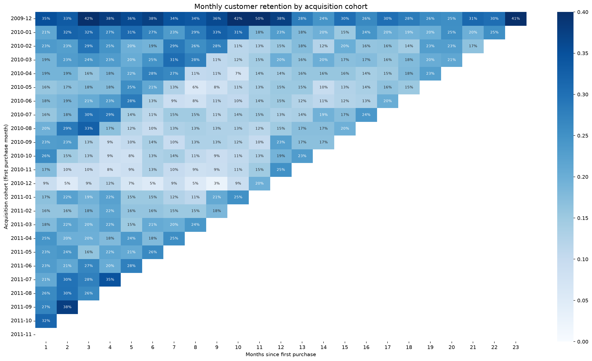
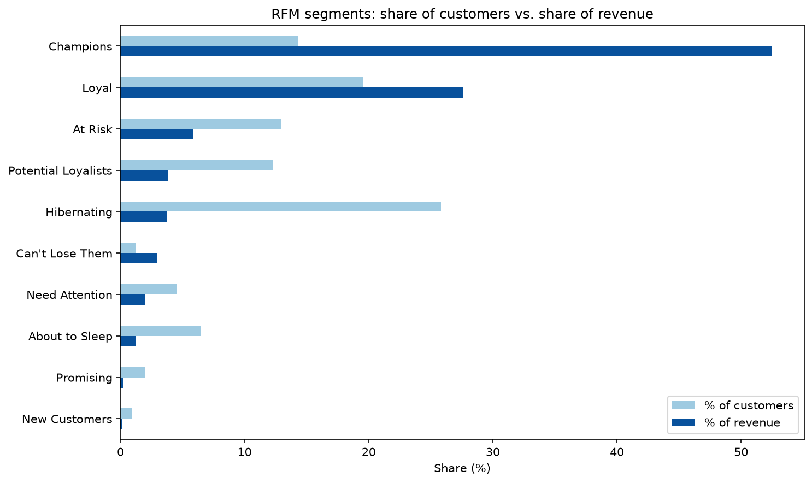
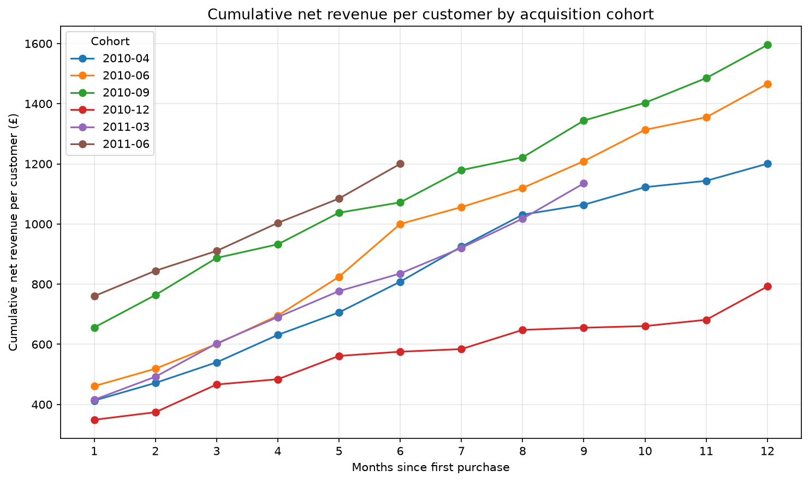

# Customer Cohort Retention & Lifetime Value Analysis

Cohort retention, RFM segmentation, and customer lifetime value analysis of ~1 million transactions from a UK online gift retailer, built in Python (pandas, matplotlib, seaborn).

## Key results

- **34% of customers generate 80% of net revenue.** Champions and Loyal customers carry the business.
- **Holiday-acquired customers are worth the least.** The December 2010 cohort had the weakest retention and the lowest 12-month value of any full-year cohort (£792 per customer), and retention, segmentation, and LTV all point the same way.
- **First-month revenue understates customer value by 2-3x.** Acquisition decisions based on first-order revenue would systematically undervalue customers.
- **72 lapsed high-value accounts** (£479K in historical revenue) are identified for personal win-back outreach.

## The question

An online gift retailer wants to know which customers are worth investing in and how quickly new customers are lost:

- How well does each monthly cohort of new customers keep buying?
- Which customer segments drive revenue, and which have gone quiet?
- How much is a new customer worth after 1, 3, 6, and 12 months?

## Data

[Online Retail II](https://archive.ics.uci.edu/dataset/502/online+retail+ii) from the UCI Machine Learning Repository (CC BY 4.0): every transaction for a UK-based online gift retailer from December 2009 to December 2011, about 1.07 million line items. Many of its customers are wholesalers.

**Cleaning decisions:**
- Removed 34,335 exact duplicate rows and non-product entries (postage, fees, manual adjustments, gift vouchers).
- Removed transactions with no Customer ID: 23% of rows but only 13.6% of revenue, so the analysis still covers most of the business's sales value.
- Calculated revenue **net of cancellations**. One customer had bought £77,353 and cancelled £77,184. Without netting, they would have ranked among the most valuable customers.
- Excluded December 2011, which has only 9 days of data, and treated the December 2009 cohort as the existing customer base rather than new customers, since the data starts that month.

After cleaning: 776,577 purchase lines from 5,852 customers.

## Findings

### 1. Cohort retention



- A typical cohort keeps **16-26% of its customers in the first month after acquisition**, then roughly holds that level. Customers who come back once tend to keep coming back.
- **Holiday-acquired cohorts retain worst.** The December 2010 cohort (the palest row) sits mostly at 3-12% through its first year, against roughly 15-25% for spring 2010 cohorts.
- **The diagonal bands are seasonality.** The darker diagonal cells all fall in October-November. Every cohort, whatever its age, buys more in the run-up to the holidays, so retention depends on the calendar as much as on customer tenure.

### 2. RFM segmentation



- **Champions are 14% of customers and 52% of net revenue.** Champions and Loyal together are 34% of customers and 80% of revenue.
- **Hibernating is the largest segment** (26% of customers) but brings in only 4% of revenue.
- **"Can't Lose Them"**: 72 customers averaging 16 orders and £6,648 each, who haven't bought in about 11 months, representing £479K of historical revenue.

### 3. Customer lifetime value



- **First-month revenue is only 30-50% of 12-month value.** A customer's first month substantially understates what they're worth.
- **Holiday cohorts are worth the least.** 12-month LTV falls through the autumn: October 2010 £1,019, November £913, December £792. The December 2010 curve (red) flattens from month 6 to month 11 as most of those customers stop buying.
- **September 2010 is the strongest 2010 cohort** (£1,596 at 12 months). One possible explanation is wholesalers stocking up before Christmas, but the data can't confirm who the buyers are.

## Recommendations

1. **Protect Champions and Loyal customers.** They're a third of the customer base and 80% of revenue, so retention and loyalty spend belongs here.
2. **Win back "Can't Lose Them" personally.** 72 high-value lapsed accounts is a small enough list for sales calls or account reviews rather than an email campaign.
3. **Nurture Potential Loyalists** (717 recent buyers averaging 2.6 orders) toward a second and third order. This is the main growth lever.
4. **Judge acquisition on 6- or 12-month LTV, not first-order revenue.** Payback windows and allowable cost per acquisition set on first-month revenue would undervalue customers by 2-3x.
5. **Be careful with holiday acquisition spend.** December-acquired customers are worth the least. If holiday campaigns are judged on immediate revenue, they'll look better than they are over time.
6. **Deprioritize Hibernating customers.** A quarter of the customer base for 4% of revenue warrants low-cost automated reactivation at most.

## Limitations

- **Two years of data, starting mid-relationship.** Early cohorts include existing customers and are inflated, so comparisons start from April 2010. Only one full holiday-to-holiday cycle is observed.
- **23% of transactions have no Customer ID** and are excluded (13.6% of revenue).
- **No marketing or channel data**, so the analysis shows *that* holiday customers are weaker, not *why*.
- **LTV is historical, not predicted.** A probabilistic model such as BG/NBD would be a natural next step for forecasting future customer value.

## Repository structure

```
customer-cohort-ltv-analysis/
├── notebooks/
│   └── cohort_ltv_analysis.ipynb   # Full analysis with code and commentary
├── images/                         # Charts used in this README
├── data/raw/                       # Raw data goes here (not tracked in git)
├── requirements.txt
└── README.md
```

## How to run

1. Clone the repo and create a virtual environment:
```bash
   git clone https://github.com/ZackSmith16/customer-cohort-ltv-analysis.git
   cd customer-cohort-ltv-analysis
   python -m venv .venv
   source .venv/bin/activate
   pip install -r requirements.txt
```
2. Download the dataset from the [UCI Machine Learning Repository](https://archive.ics.uci.edu/dataset/502/online+retail+ii), unzip it, and place `online_retail_II.xlsx` in `data/raw/`.
3. Open `notebooks/cohort_ltv_analysis.ipynb` and run all cells. The first run converts the Excel file to Parquet (about 1-2 minutes); later runs load in seconds.

## Data source

Chen, D. (2012). *Online Retail II* [Dataset]. UCI Machine Learning Repository. Licensed under [CC BY 4.0](https://creativecommons.org/licenses/by/4.0/).